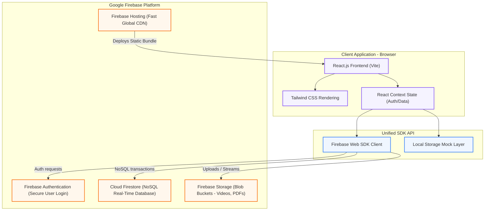

# System Architecture Diagram

This document explains the cloud service architecture of the E-Learning Management System, highlighting the interaction between client applications and serverless backend layers.

## Architectural Breakdown

### 1. Presentation Layer (React + Tailwind)
- Renders dashboards (Student, Instructor, Admin) in a responsive viewport.
- Compiled by Vite into a static bundle (HTML, CSS, JS) optimized for low bandwidth loading.

### 2. Service Abstraction (db.js & storage.js)
- Acts as a gateway. Checks whether environment variables are initialized.
- If present, invokes the Firebase Web SDK Client.
- If absent, routes requests to a browser `localStorage` mock database, allowing local execution without configuring Google accounts.

### 3. Serverless Cloud Services (Firebase)
- **Firebase Authentication:** Handles login hash checks and token issuance.
- **Cloud Firestore:** A NoSQL database storing structured JSON documents with automated scaling and socket listeners.
- **Firebase Storage:** Stores raw files (videos, templates, submissions) inside secure Google Cloud storage buckets.
- **Firebase Hosting:** Distributes static files using CDN edge caches with built-in SSL.
