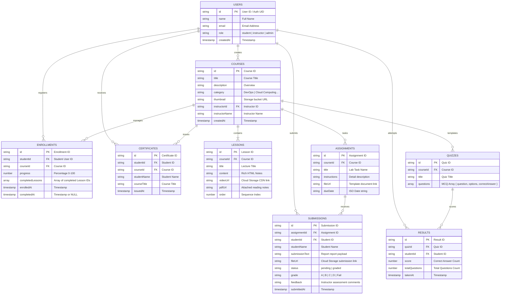

# Entity Relationship (ER) Diagram

This document contains the Entity Relationship diagram of the Cloud-Based E-Learning Management System, modeled for NoSQL Cloud Firestore collection mapping.

## Relational Schema Mapping Description

1. **Users to Contexts:** Users are partitioned by the `role` attribute. The application routes dashboard layouts according to this permission matrix.
2. **Courses to Syllabus (Lessons/Assignments/Quizzes):** A single Course is a parent container mapping many lessons, assignments, and quizzes. In Firestore, these can be mapped either as sub-collections or as discrete collections filtered by the `courseId` reference.
3. **Submissions and Results:** These entities record interactive checkpoints. Submissions reference both the assignment key and student key; Results reference both the quiz key and student key.
4. **Certificates:** Instantiated only when the student's progress reaches `100%`.
