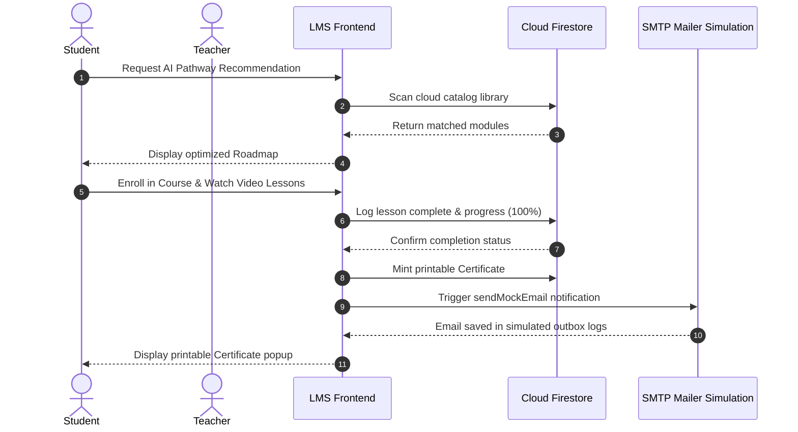
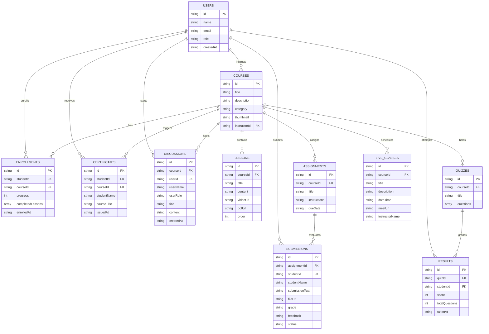

# B.Tech Mini Project Report: Cloud-Based E-Learning Management System

**Course:** B.Tech CSE (Cloud Computing Specialization)  
**Project Title:** Cloud-Based E-Learning Management System (LMS)  
**Academic Session:** 2026

---

## Abstract
The rapid shift towards digital classrooms demands educational platforms that are highly available, secure, and globally scalable. Traditional E-learning sites deployed on local physical servers suffer from bandwidth bottlenecks, hardware maintenance overheads, and security vulnerabilities. This project implements a **Cloud-Based E-Learning Management System (LMS)** that is 100% software-based, leveraging a serverless architecture to deploy static content and manage resources. 

The application utilizes **React.js** for frontend state rendering and **Tailwind CSS** for responsive glassmorphic styles. The backend utilizes **Google Firebase** services: Firebase Authentication for identity validation, Cloud Firestore for real-time NoSQL data synchronization, Firebase Storage for stateless media streaming, and Firebase Hosting for content delivery via a global CDN. A hybrid adapter layer is implemented to allow offline execution on local storage when cloud API keys are absent, ensuring high reliability.

---

## Chapter 1: Introduction
### 1.1 Background
Traditional school architectures depend on central databases and local web servers. When user enrollments spike during examination terms, these local systems experience service interruptions. Cloud computing solves this scalability bottleneck by offering self-provisioning, automated resource allocation, and utility-based pricing.

### 1.2 Problem Statement
Legacy LMS models are hardware-constrained. In a university department project, setting up dedicated server hardware, database administrators, and SSL certificates is costly. There is a need for a serverless, pay-as-you-go e-learning platform that satisfies the following parameters:
- Authenticate student credentials securely.
- Stream lecture recordings stateless.
- Store quizzes, grades, and records with zero server maintenance.

### 1.3 Project Objectives
- Develop a responsive React application configured for three user access levels (Student, Instructor, Admin).
- Store structured data inside Firestore collections using structured schemas.
- Enable storage uploads for laboratory reports and video records via Firebase Storage.
- Maintain a dark/light mode and responsive views.

---

## Chapter 2: Literature Review & Cloud Frameworks
This project compares classical Monolithic Web Hosting with Serverless Hosting architectures:

| Parameter | Monolithic Hosting | Serverless Hosting (Firebase) |
|---|---|---|
| **Database Scaling** | Manual sharding and replica provisioning | Auto-sharding managed by Firestore |
| **Media Distribution** | Local storage bandwidth bottlenecks | Firebase Storage CDN caching |
| **Authentication** | Custom database hash checking | Firebase Auth JWT verification |
| **Maintenance** | Operating system updates required | Zero-server operations |

---

## Chapter 3: System Design & Database Schema
### 3.1 Structural Architecture
The application is structured into a stateless presentation view and a backend storage tier. 
- **Presentation:** React hooks handle inputs and manage state.
- **Service Layer:** [db.js](file:///c:/Users/priya/Downloads/kiddo/src/services/db.js) abstracts data fetching. It verifies the configuration context: if the Firebase SDK fails to establish a cloud connection (due to invalid API credentials), it switches to local database storage structures in `localStorage`.

### 3.2 Academic UML Design Models

#### 3.2.1 Use Case Diagram
This diagram outlines role-based access control boundaries: Student learning loops, Teacher classroom publishing controls, and Administrator security auditing.

```mermaid
usecaseDiagram
    actor Student
    actor Teacher
    actor Admin
    
    rectangle "Cloud E-Learning Management System (LMS)" {
        Student --> (Register/Login)
        Student --> (Browse & Enroll in Courses)
        Student --> (Watch Video Lectures)
        Student --> (Submit Lab Assignments)
        Student --> (Take Online Quizzes)
        Student --> (Download Certificates)
        Student --> (Ask AI Course Recommendations)
        Student --> (Post in Discussion Forum)
        Student --> (Join Google Meet Live Class)
        
        (Create & Edit Courses) <-- Teacher
        (Upload Study Notes/Videos) <-- Teacher
        (Grade Lab Submissions) <-- Teacher
        (Schedule Live Classes) <-- Teacher
        (Moderate Discussion Forum) <-- Teacher
        
        Admin --> (Manage Instructors/Students Accounts)
        Admin --> (Global Course Deletion/Audit)
        Admin --> (Audit Credentials & Certificate Ledger)
        Admin --> (Audit SMTP Email Dispatch Logs)
        Admin --> (Monitor Platform Performance Analytics)
    }
```

#### 3.2.2 Data Flow Diagram (DFD) - Level 0 & Level 1
Shows data transmission paths between external entities (Student, Teacher, Admin) and platform processing modules.

```mermaid
graph TD
    subgraph DFD Level 0 (Context Diagram)
        S[Student] -- Enroll / Submissions / Quiz Answers --> LMS[Cloud E-Learning LMS]
        T[Teacher] -- Courses / Lessons / Grades --> LMS
        A[Admin] -- Manage Users / Global Purges / Audit Logs --> LMS
        LMS -- Certificates / Course Material / Recommendations --> S
        LMS -- Progress Records / Student Submissions --> T
        LMS -- Analytics / Mail Outbox Status --> A
    end
```

```mermaid
graph TD
    subgraph DFD Level 1 (Process Breakdown)
        Student[Student] -->|Auth Info| P1["1.0 User Authentication"]
        Teacher[Teacher] -->|Auth Info| P1
        Admin[Admin] -->|Auth Info| P1
        
        P1 -->|Session Token| P2["2.0 Course Catalog & Path Planner"]
        Student -->|Goal Query| P2
        P2 -->|AI Roadmaps| Student
        
        Teacher -->|Course Metadata / Video upload| P3["3.0 Course Syllabus Creation"]
        P3 -->|Stateless Stream| Student
        
        Student -->|Lab Submission / Quiz Answers| P4["4.0 Assessment Grading Engine"]
        P4 -->|Submissions| Teacher
        Teacher -->|Score Grade / Comments| P4
        P4 -->|Email Alerts| P6["6.0 Simulated SMTP Outbox"]
        
        P4 -->|100% Progress Trigger| P5["5.0 Certificate Issuer Ledger"]
        P5 -->|Printable PDF| Student
        
        Admin -->|Account Profile Creation / Removal| P1
        Admin -->|SMTP Email Audit & Metrics| P6
    end
```

#### 3.2.3 Sequence Diagram: Student Completion Loop
Illustrates chronological message interactions for student recommendations, video tracking, auto-grading, and credentials ledger updates.



#### 3.2.4 Entity-Relationship (ER) Diagram
Defines primary-foreign key relationships mapping the real-time NoSQL store.



### 3.3 Database Schema Collections
The platform creates eleven Firestore document templates:
1. `users`: Fields (`id`, `name`, `email`, `role`, `createdAt`).
2. `courses`: Fields (`id`, `title`, `description`, `category`, `thumbnail`, `instructorId`).
3. `lessons`: Fields (`id`, `courseId`, `title`, `content`, `videoUrl`, `pdfUrl`, `order`).
4. `enrollments`: Fields (`id`, `studentId`, `courseId`, `progress`, `completedLessons`, `enrolledAt`).
5. `assignments`: Fields (`id`, `courseId`, `title`, `instructions`, `dueDate`).
6. `submissions`: Fields (`id`, `assignmentId`, `studentId`, `studentName`, `submissionText`, `fileUrl`, `grade`, `feedback`, `status`).
7. `quizzes`: Fields (`id`, `courseId`, `title`, `questions`).
8. `results`: Fields (`id`, `quizId`, `studentId`, `score`, `totalQuestions`).
9. `certificates`: Fields (`id`, `studentId`, `courseId`, `studentName`, `courseTitle`, `issuedAt`).
10. `discussions`: Fields (`id`, `courseId`, `userId`, `userName`, `userRole`, `title`, `content`, `replies`, `createdAt`).
11. `live_classes`: Fields (`id`, `courseId`, `title`, `description`, `dateTime`, `meetUrl`, `instructorName`).

---

## Chapter 4: Implementation Methodology
### 4.1 Frontend Layouts
The styling relies on Tailwind utilities to render visual grids. Dark mode states are managed by appending the `.dark` selector class to the HTML document root node. Icons are rendered using Lucide vector icons.

### 4.2 Local Fallback Adaptation
The hybrid adapter design utilizes a checking function:
```javascript
const isValidConfig = firebaseConfig.apiKey && firebaseConfig.apiKey !== "YOUR_API_KEY";
```
If `isValidConfig` evaluates to false, the system retrieves mock assets from local memory. This ensures that the code runs perfectly during demonstrations, even if internet access is limited.

---

## Chapter 5: Verification & Results
### 5.1 Test Case Scenarios

| Test ID | Scenario | Input Parameters | Expected Result | Status |
|---|---|---|---|---|
| TC-01 | User Registration | Role: Student, email: student@test.com | Account created, database record initialized | Passed |
| TC-02 | Course Enrollment | Course: "Introduction to Cloud" | Progress record created in `enrollments` collection | Passed |
| TC-03 | Timed Quiz Session | Answers: [B, A, C] | Quiz graded instantly, score logged in `results` | Passed |
| TC-04 | Assignment Grading | Select Grade: A, Feedback: "Excellent" | Grade updated in `submissions`, notify student | Passed |
| TC-05 | Certificate Generation | Completed lessons: 3/3 (100%) | Verification certificate generated, printable | Passed |

---

## Chapter 6: Conclusion & Future Scope
### 6.1 Conclusion
The Cloud-Based E-Learning Management System successfully demonstrates how serverless utilities can replace local server infrastructure. The project reduces setup time from hours to minutes while maintaining scalability and security.

### 6.2 Future Directions
- **Machine Learning Integration:** Recommend modules based on students' performance logs.
- **Microservices Deployment:** Deploy serverless Firebase Functions to compile and grade student programming reports.
